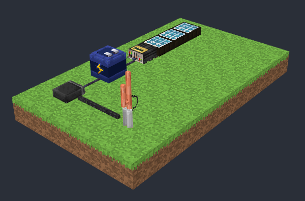

# MineWebView

An open system for showing Minecraft builds on a website, in 3D you can turn around with the mouse or a finger.
Developed for the [RadioCraft](https://github.com/RadiocraftARRL/RadioCraft) wiki, usable on any site.



```html
<mine-web-view src="builds/first_station.json"></mine-web-view>
```

It shows two kinds of file:

- **A glTF model** (`.glb` / `.gltf`), shown as it is. A Minecraft exporter mod that writes these from a build in game,
  block entity renderers and all, is planned.
- **A scene** (`.json`): a list of blocks and their states. The viewer builds it in the page from the blocks' own
  blockstate, model and texture files, the same files a mod or resource pack ships, so a build on your site is drawn
  from the real models and stays in step with them.

## Setup

MineWebView is plain ES modules on top of [three.js](https://threejs.org) (0.160 or later), with no build step. Give the
page an import map for three.js and load the element:

```html
<script type="importmap">
	{ "imports": {
		"three": "https://cdn.jsdelivr.net/npm/three@0.160.0/build/three.module.js",
		"three/addons/": "https://cdn.jsdelivr.net/npm/three@0.160.0/examples/jsm/"
	} }
</script>
<script type="module" src="mine-web-view/src/mine-web-view.js"></script>

<mine-web-view src="builds/first_station.json" auto-rotate></mine-web-view>
```

Try `demo/index.html` from a local web server (`python -m http.server` in this folder, then
http://localhost:8000/demo/). Opened straight from disk, the browser will not let it load the files.

### Attributes

| Attribute     | What it does |
|---------------|--------------|
| `src`         | The model (`.glb`, `.gltf`) or scene (`.json`). |
| `assets`      | Asset roots for a scene, comma separated, relative to the page. Overrides the scene's own `assets`. |
| `auto-rotate` | Turns slowly until someone touches it. |
| `background`  | A CSS colour behind the build. Transparent by default. |
| `zoom`        | How far away the camera starts: 1 (the default) just fits the build. |

The element is 4:3 by default; size it with CSS like an image. It fires `load` once the build is shown and `error` if
it could not be loaded.

## Scenes

```json
{
  "assets": ["../assets/"],
  "tints": { "default": "#7fb238" },
  "blocks": [
    { "from": [0, -1, 0], "to": [5, -1, 5], "block": "minewebview:grass_block" },
    { "pos": [1, 0, 1], "block": "radiocraft:vhf_base_station[facing=north]" },
    { "pos": [2, 0, 1], "block": "radiocraft:wire", "state": { "east": "true" } },
    { "pos": [3, 0, 1], "model": "radiocraft:block/dummy_load", "y": 90 }
  ]
}
```

- **`assets`**: one or more folders laid out like a resource pack's `assets` folder (`<root>/<namespace>/blockstates/`,
  `models/`, `textures/`), relative to the scene file. Each file is looked for in the roots in order.
- **`blocks`**: each entry is a block at `pos` (x east, y up, z south, as in the game), given as a block id and a
  `state`, or as one string `"ns:id[key=value,...]"`, or a `model` with optional `x`/`y` rotation. `from` and `to`
  instead of `pos` fill a box.
- **`tints`**: the colour for faces with a `tintindex` (grass, leaves); a block entry's `tint` picks one by name or
  gives a colour.
- **`wires`**: wires strung between blocks, `{ "from": [x, y, z], "to": [x, y, z] }` with optional `color`, `width`
  and `anchor` (where in each block the wire is held, `[0.5, 0.5, 0.5]` by default). They are drawn the way the game
  draws a leash: two thin crossed ribbons in bands, curving when the ends are at different heights.

A state property the scene leaves out matches any variant, as if it were at the block's default, so a build copied
from a guide book (which names only the properties that matter) still finds its models.

What it draws: models with parents, texture variables, elements with per-face UVs and UV rotation, element rotation
(with rescale), blockstate variants and multipart, x/y rotation, cullfaces against full neighbouring blocks, the
first frame of animated textures, and the game's face shading. It does not draw block entities (chests, signs,
anything a mod renders in code), fluids, or biome colours beyond one tint per name; a glTF export will.

### Built-in parents

`minecraft:block/block`, `cube`, `cube_all`, `cube_column`, `cube_bottom_top`, `cube_top`, `orientable` and
`orientable_with_bottom` are built in, so models that inherit from them need no Minecraft files. Any other vanilla
model or texture has to be in one of the scene's asset roots.

### Custom model loaders

A mod whose models are put together in code (a wire that draws a stub towards each neighbour, say) can teach the viewer
its loader. The function gets the block, its state, the raw model JSON and a `blockAt(dx, dy, dz)` lookup of the
neighbouring scene entries, and returns the part models to draw:

```js
import { SceneBuilder } from './mine-web-view/src/mine-web-view.js';

SceneBuilder.registerLoader('radiocraft:wire', ({ block, model, blockAt }) => {
	const parts = [{ model: model.prefix + 'middle' }];
	for (const [dx, dz, y] of [[0, -1, 0], [1, 0, 90], [0, 1, 180], [-1, 0, 270]])
		if (blockAt(dx, 0, dz))
			parts.push({ model: model.prefix + 'horizontal', y });
	return parts;
});
```

Register loaders before the first `<mine-web-view>` loads its scene.

## Scenes to .glb

`src/export.js` turns a scene into a `.glb` with its textures inside (`sceneToGlb`, `sceneUrlToGlb`), so a site can
serve one file per build and no resource files at all. `tools/export.html` does it in a browser: serve it where it can
fetch your scenes and open `tools/export.html?scene=builds/first_station.json&loaders=loaders.js` (repeat `scene=` for
more; the files download). A loaders script registers your custom model loaders, importing `SceneBuilder` from
`'minewebview'`, which the page maps to its own copy. The faces keep the game's shading as vertex colours on unlit
materials, and the textures stay pixel-sharp.

## Minecraft's own assets

This repository contains no Minecraft textures or models: the demo's grass and dirt are drawn for it (CC0, see
`tools/demo_assets.py`), and the built-in parents are written out here. If you show vanilla blocks on your site, you
supply those files yourself, and the usual rules for Minecraft fan content apply. The screenshot above uses
RadioCraft's own models and textures.

## License

GPL-3.0. The demo assets under `demo/assets` are CC0.
